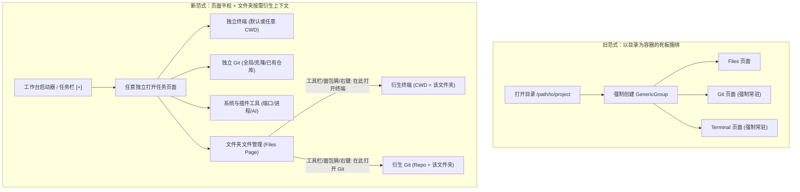
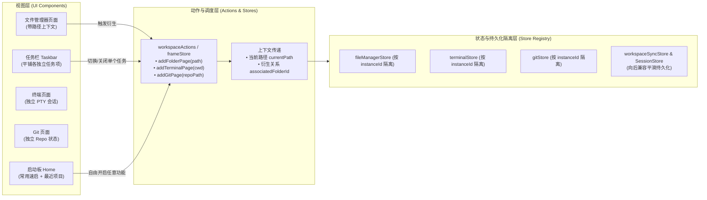
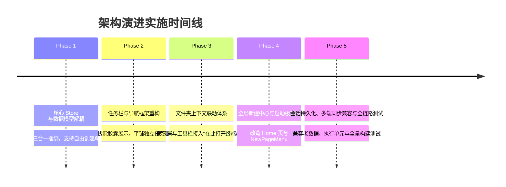

# VibeGo 页面平权与上下文联动架构改造规划方案
## Page-Centric & Contextual Expansion Architecture Plan
### 告别目录工作区强捆绑，构建轻量、灵活、按需衍生的现代开发工作台

---

## 一、改造定位与核心理念转变 (Strategic Paradigm Shift)

### 1. 现行“目录容器工作区”问题诊断

在 VibeGo 当前的设计中，“工作区 (Workspace)”与“打开目录 (Folder Group)”深度捆绑：
1. **死板的三合一胶囊捆绑**：每当用户打开一个文件夹，系统在 [`frame-store.ts`](file:///home/xxnuo/projects/VibeGo/ui/src/stores/frame-store.ts) 中强制生成一个包含 `[Files, Git, Terminal]` 三个页面的复合 `GenericGroup`。
2. **任务栏的胶囊枷锁**：在 [`taskbar-item-view.tsx`](file:///home/xxnuo/projects/VibeGo/ui/src/components/frame/taskbar-item-view.tsx) 中，这三个页面的图标被硬编码包裹在一个胶囊栏内；不仅挤占宝贵的屏幕空间（尤其在移动端竖屏），而且使得任务层级异常复杂。
3. **页面地位不平等**：除外围工具插件外，核心开发能力（文件、终端、Git）无法作为平等的一级公民自由创建与销毁。用户如果只想打开一个终端跑命令，必须先打开或伪装成一个文件夹；首页 ([`home-page.tsx`](file:///home/xxnuo/projects/VibeGo/ui/src/components/home/home-page.tsx)) 也被局限为“输入路径 / 浏览目录”的单一启动入口。

### 2. 新架构：页面平权化 + 文件夹上下文联动



- **页面平权 (First-Class Pages)**：
  - 终端、Git、文件浏览器、插件工具等均为平等的独立任务项（Task）。
  - 用户可随时从新建中心或启动板打开任意页面，不再强制要求依赖文件夹容器。
- **文件夹为上下文发生器 (Context Generator)**：
  - 打开文件夹只打开一个轻量、纯粹的文件管理器页面。
  - 在文件管理器的顶部路径栏、工具栏及右键菜单中，提供 **“在此打开终端 (Open Terminal Here)”** 与 **“在此打开 Git (Open Git Here)”**。
  - 用户按需一键唤出对应路径的终端或 Git 页面。
  - **彻底替代原有的三合一容器**：页面之间生命周期完全独立（关掉文件不杀终端，不需要 Git 就不加载 Git）。

---

## 二、全景架构与数据流设计 (Target Architecture)



---

## 三、核心数据结构与状态层重构 (State & Data Model)

### 1. `frame-store.ts` 任务实例模型升级

将 `PageGroup` 统一升级为平权的任务实例模型，废除 `GenericGroup` 强制内嵌 3 页面的逻辑：

```typescript
// 建议定义平权任务实例（或重构 PageGroup）
export interface TaskPageItem {
  id: string;               // 唯一实例 ID，如 "task-uuid"
  pageType: string;         // "files" | "terminal" | "git" | "process-monitor" | "settings" | "home" | ...
  title: string;            // 页面标题，如 "终端 (VibeGo)"、"Files (VibeGo)"
  path?: string;            // 关联上下文路径（作为终端 cwd 或 Git repoPath）
  associatedFolderId?: string; // 关联的来源文件夹任务 ID（可选）
  tabs: TabItem[];          // 页面内 Tab 列表（代码编辑、预览、Git Diff 等）
  activeTabId: string | null;
  data?: Record<string, unknown>; // 私有页面状态
}
```

#### 关键 Store 动作改造：
1. **`addFolderGroup(path: string, name?: string)`**：
   - 改造前：创建一个包含 `files`, `git`, `terminal` 3 个页面的 `GenericGroup`。
   - 改造后：仅创建一个 `pageType: "files"` 的单页面任务，记录其路径 `path`。
2. **`addTerminalGroup(cwd?: string, title?: string, associatedFolderId?: string)`**：
   - 支持传入初始 `cwd` 与标题，独立创建终端任务。
3. **`addGitGroup(repoPath?: string, title?: string, associatedFolderId?: string)`**：
   - 新增独立 Git 任务创建动作，传入目标仓库路径。
4. **`removeGroup(id: string)`**：
   - 仅销毁当前单个任务，不再发生“关闭工作区导致所有终端被一次性全杀”的非预期行为。

### 2. 实例级 Store 隔离与上下文注入

- **终端 Store ([`terminal-store.ts`](file:///home/xxnuo/projects/VibeGo/ui/src/stores/terminal-store.ts))**：
  - 目前内部已按 `groupId` 实现 `terminalsByGroup: Record<string, TerminalSession[]>` 的数据隔离。
  - 在创建 PTY 会话时，优先使用任务实例配置的 `cwd` 作为工作目录；若未指定则回退到系统默认目录。
- **Git Store ([`git-store.ts`](file:///home/xxnuo/projects/VibeGo/ui/src/stores/git-store.ts))**：
  - 目前已支持 `getOrCreateGitStore(groupId)`。
  - 打开 Git 页面时传入 `repoPath` 并调用 `checkRepo(path)`；若不是有效 Git 仓库，自动展现已有的“初始化仓库 / 克隆仓库”引导界面。
- **文件管理器 Store ([`file-manager-store.ts`](file:///home/xxnuo/projects/VibeGo/ui/src/stores/file-manager-store.ts))**：
  - 保持基于 `groupId` 隔离当前浏览路径与选中态。

### 3. 会话持久化与 Local-First 协议向后兼容

- **服务端数据库实体 ([`internal/model/workspace_entity.go`](file:///home/xxnuo/projects/VibeGo/internal/model/workspace_entity.go)) 保持零破坏**：
  - `WorkspaceFolder`：映射保存 `files` 页面任务（存储 `path` 与 `name`）；
  - `WorkspaceTool`：映射保存独立 `terminal`、独立 `git` 及其他插件页面，在 `Data` JSON 字段中存储其 `cwd` / `path` 与 `associatedFolderId`。
- **客户端反序列化兜底 ([`session-store.ts`](file:///home/xxnuo/projects/VibeGo/ui/src/stores/session-store.ts))**：
  - 当加载老版本保存的三合一 `GenericGroup` 时，自动平滑解构为独立任务项，保证用户现有历史数据不丢失。

---

## 四、前端交互与组件重构方案 (UI/UX Engineering)

### 1. 任务栏解耦与平铺展示 ([`taskbar-item-view.tsx`](file:///home/xxnuo/projects/VibeGo/ui/src/components/frame/taskbar-item-view.tsx))

- **移除胶囊分组容器**：删除对 `group.type === "group"` 的多图标集合渲染逻辑。
- **统一单项呈现**：
  - 任务栏中每一个 Item 为一个独立的按钮，展示该任务的专用图标（终端：`Terminal`、Git：`GitGraph`、文件：`FolderOpen`、工具：对应插件图标）。
  - 激活指示器：遵从主题风格，仅对当前激活的任务项赋予背景高亮与焦点状态。
  - 提示信息 (Tooltip / Bubble)：显示 `页面名称 - 路径`（如 `终端 - ~/VibeGo`）。
  - 右键菜单 ([`taskbar-item-menu.tsx`](file:///home/xxnuo/projects/VibeGo/ui/src/components/frame/taskbar-item-menu.tsx))：提供“关闭此任务”、“关闭其他任务”、“在此打开终端”（若当前项为文件夹）等快捷操作。

### 2. 文件夹页面内上下文衍生 ([`file-manager.tsx`](file:///home/xxnuo/projects/VibeGo/ui/src/components/file/file-manager.tsx))

在文件浏览器中提供直观、易用的触达点：
1. **顶部路径面包屑 ([`file-manager-breadcrumb.tsx`](file:///home/xxnuo/projects/VibeGo/ui/src/components/file/file-manager-breadcrumb.tsx))**：
   - 路径末尾增加操作下拉菜单或图标按钮：
     - 📟 **在此打开终端** -> `addTerminalGroup(currentPath, `终端 (${folderName})`, groupId)`
     - 🌿 **在此打开 Git** -> `addGitGroup(currentPath, `Git (${folderName})`, groupId)`
2. **工具栏快捷操作 ([`file-manager-toolbar.tsx`](file:///home/xxnuo/projects/VibeGo/ui/src/components/file/file-manager-toolbar.tsx))**：
   - 宽屏端直接显示快速终端与 Git 图标；
   - 移动端置于 `MoreHorizontal` 更多操作抽屉的顶部显眼位置。
3. **右键/长按菜单 ([`file-detail-sheet.tsx`](file:///home/xxnuo/projects/VibeGo/ui/src/components/file/file-detail-sheet.tsx))**：
   - 对文件夹列表项长按或右键呼出详情抽屉时，操作网格中增加“在终端打开”。

### 3. 全局新建中心 ([`new-page-menu.tsx`](file:///home/xxnuo/projects/VibeGo/ui/src/components/common/new-page-menu.tsx))

- 升级 [`registry.ts`](file:///home/xxnuo/projects/VibeGo/ui/src/framework/workbench/registry.ts) 与 [`pages/index.ts`](file:///home/xxnuo/projects/VibeGo/ui/src/pages/index.ts)：
  - 将 `files`、`git`、`terminal` 与所有插件工具平权注册为可从新建菜单直接调用的页面。
  - 提供分类视图与快捷搜索：
    - **开发核心**：打开文件夹、新终端、Git 仓库；
    - **工具插件**：AI 会话、进程监视器、端口管理、远程桌面等。

### 4. 首页 (Home Dashboard) 改造 ([`home-page.tsx`](file:///home/xxnuo/projects/VibeGo/ui/src/components/home/home-page.tsx))

- 告别单调的“输入目录路径”样式，演进为紧凑高效的开发工作台：
  - **常用速启区 (Quick Actions)**：一键新建终端、浏览文件、打开 Git、打开 AI 助手；
  - **最近文件夹 (Recent Projects)**：保留直观的历史目录卡片，点击一键以文件视图打开；
  - **当前活动任务 (Active Tasks)**：可直接查看当前后台运行中的任务列表并一键跳回。

---

## 五、分阶段实施路线图 (Phased Implementation Roadmap)



---

### Phase 1: 核心 Store 与数据模型解耦 (Core Model Decoupling)

#### 1.1 改造目标
- 废除“打开文件夹必须打包创建 files+git+terminal”的死板逻辑。
- 让文件、终端、Git 成为完全独立的任务实例，支持各自独立创建与独立关闭。

#### 1.2 涉及文件清单
- [`ui/src/stores/frame-store.ts`](file:///home/xxnuo/projects/VibeGo/ui/src/stores/frame-store.ts)
- [`ui/src/stores/workspace-actions.ts`](file:///home/xxnuo/projects/VibeGo/ui/src/stores/workspace-actions.ts)
- [`ui/src/stores/workspace-inventory.ts`](file:///home/xxnuo/projects/VibeGo/ui/src/stores/workspace-inventory.ts)
- [`ui/src/app.tsx`](file:///home/xxnuo/projects/VibeGo/ui/src/app.tsx)

#### 1.3 实施要点
1. **修改 `addFolderGroup`**：
   - 不再遍历 `getWorkspaceViews()`，改为仅包含 `type: "files"` 这一单个页面。
2. **升级 `addTerminalGroup`**：
   - 签名改为 `addTerminalGroup: (cwd?: string, name?: string, associatedFolderId?: string) => string`。
   - 创建独立的 Terminal 任务，并在 `data` 中记录 `cwd` 与关联属性。
3. **新增 `addGitGroup`**：
   - 增加 `addGitGroup: (repoPath?: string, name?: string, associatedFolderId?: string) => string`。
   - 创建独立的 Git 任务，并在 `data` 中记录 `repoPath`。
4. **适配 `app.tsx` 的内容渲染**：
   - 优化 `renderContent()`，精准匹配并挂载对应任务的 Plugin / Page 视图。

#### 1.4 验收标准
- 在浏览器控制台或单元测试中调用 `addTerminalGroup()`，能独立新增并激活终端页面。
- 调用 `addFolderGroup()`，只生成单个文件浏览器页面，不会附带未请求的 Git 与终端。

---

### Phase 2: 任务栏与外层导航框架重构 (Taskbar & Frame Restructure)

#### 2.1 改造目标
- 彻底移除任务栏中针对 `group.type === "group"` 的三合一胶囊栏。
- 实现任务项一比一平铺，遵循 [UI 设计风格.md](file:///home/xxnuo/projects/VibeGo/docs/UI%20设计风格.md) 的统一极简风格。

#### 2.2 涉及文件清单
- [`ui/src/components/frame/taskbar-item-view.tsx`](file:///home/xxnuo/projects/VibeGo/ui/src/components/frame/taskbar-item-view.tsx)
- [`ui/src/framework/workbench/use-taskbar.ts`](file:///home/xxnuo/projects/VibeGo/ui/src/framework/workbench/use-taskbar.ts)
- [`ui/src/components/frame/taskbar-item-menu.tsx`](file:///home/xxnuo/projects/VibeGo/ui/src/components/frame/taskbar-item-menu.tsx)

#### 2.3 实施要点
1. **重写 `GroupButton`**：
   - 废除原有的 `group.pages.map(...)` 胶囊排布；
   - 针对单页面任务，直接按其真实类型（`files`、`terminal`、`git` 或各工具）渲染单个图标按钮；
   - 统一图标尺寸与点击手势判定。
2. **优化上下文气泡与 Tooltip**：
   - Tooltip 格式：`[页面名] - [关联路径]`（如 `终端 - ~/projects/VibeGo`，`Git - ~/projects/VibeGo`）。
3. **右键管理菜单**：
   - 点击“关闭”仅关闭当前单个任务项。

#### 2.4 验收标准
- 打开多个文件页、终端页和工具页时，任务栏以平铺的一级图标整齐排列。
- 移动端底部栏与桌面端左侧竖栏布局自适应正常，无折行或布局截断。

---

### Phase 3: 文件夹上下文联动体系 (Folder Contextual Expansion)

#### 3.1 改造目标
- 在文件管理器内构建顺畅的“在此打开终端”与“在此打开 Git”功能，全面取代原工作区能力。

#### 3.2 涉及文件清单
- [`ui/src/components/file/file-manager-toolbar.tsx`](file:///home/xxnuo/projects/VibeGo/ui/src/components/file/file-manager-toolbar.tsx)
- [`ui/src/components/file/file-manager-breadcrumb.tsx`](file:///home/xxnuo/projects/VibeGo/ui/src/components/file/file-manager-breadcrumb.tsx)
- [`ui/src/components/file/file-detail-sheet.tsx`](file:///home/xxnuo/projects/VibeGo/ui/src/components/file/file-detail-sheet.tsx)
- [`ui/src/components/file/file-manager.tsx`](file:///home/xxnuo/projects/VibeGo/ui/src/components/file/file-manager.tsx)
- [`ui/src/lib/i18n/locales/zh.json`](file:///home/xxnuo/projects/VibeGo/ui/src/lib/i18n/locales/zh.json) & [`en.json`](file:///home/xxnuo/projects/VibeGo/ui/src/lib/i18n/locales/en.json)

#### 3.3 实施要点
1. **多语言词条补充**：
   - `fileManager.openTerminalHere`: "在此处打开终端" / "Open Terminal Here"
   - `fileManager.openGitHere`: "在此处打开 Git" / "Open Git Here"
2. **面包屑操作栏与工具栏接入**：
   - 在面包屑路径栏右侧或下拉处，添加终端与 Git 图标按钮；
   - 点击时读取 `fileManagerStore` 当前所处的绝对路径 `currentPath`；
   - 调用 `addTerminalGroup(currentPath, `终端 (${folderName})`, groupId)`；
   - 调用 `addGitGroup(currentPath, `Git (${folderName})`, groupId)`。
3. **文件夹详情抽屉接入**：
   - 当选中的项目为目录时，在操作区展示“在终端打开”，支持从子目录直接起终端。

#### 3.4 验收标准
- 浏览至 `/home/xxnuo/projects/VibeGo`，点击“在此打开终端”，新终端启动并默认处于该目录，`pwd` 验证正确。
- 点击“在此打开 Git”，新 Git 页面立即载入该项目的 Git 分支与变更，状态一致。

---

### Phase 4: 全局新建中心与启动板升级 (Launcher & Home Dashboard)

#### 4.1 改造目标
- 首页升级为综合开发启动板；新建菜单支持平权罗列所有页面。

#### 4.2 涉及文件清单
- [`ui/src/pages/index.ts`](file:///home/xxnuo/projects/VibeGo/ui/src/pages/index.ts)
- [`ui/src/framework/workbench/registry.ts`](file:///home/xxnuo/projects/VibeGo/ui/src/framework/workbench/registry.ts)
- [`ui/src/components/common/new-page-menu.tsx`](file:///home/xxnuo/projects/VibeGo/ui/src/components/common/new-page-menu.tsx)
- [`ui/src/components/home/home-page.tsx`](file:///home/xxnuo/projects/VibeGo/ui/src/components/home/home-page.tsx)

#### 4.3 实施要点
1. **页面注册分类规范化**：
   - 调整 `pageRegistry`，将 `files`、`git`、`terminal` 声明为支持独立启动的一级页面，并补充规范的 `titleKey` 与图标。
2. **新建菜单分类过滤**：
   - 将原有仅展示 `category === "tool"` 改为全量分类展示：
     - 开发（文件管理器、终端、Git）；
     - 实用工具（AI 会话、进程监视、端口管理、远程桌面）；
     - 系统（设置）。
3. **首页 (Home Page) 升级**：
   - 重塑头部引导，增加常用工具快捷卡片；
   - 保留最近项目列表，并增加“新建独立终端 / Git”的直达按钮。

#### 4.4 验收标准
- 点击顶部/底部的 `+` 按钮，能够通过新建菜单直接打开空白终端或 Git 仓库。
- 首页功能模块清晰紧凑，符合 IDE 工具质感。

---

### Phase 5: 会话持久化、多端同步兼容与全链路测试 (Persistence & Verification)

#### 5.1 改造目标
- 保证旧版本会话数据与新版平权模型无缝迁移，验证刷新、离线自愈与并发安全。

#### 5.2 涉及文件清单
- [`ui/src/stores/session-store.ts`](file:///home/xxnuo/projects/VibeGo/ui/src/stores/session-store.ts)
- [`ui/src/stores/session-workspace-guard.ts`](file:///home/xxnuo/projects/VibeGo/ui/src/stores/session-workspace-guard.ts)
- [`ui/src/stores/workspace-sync-store.ts`](file:///home/xxnuo/projects/VibeGo/ui/src/stores/workspace-sync-store.ts)

#### 5.3 实施要点
1. **旧会话数据迁移器 (Migration Adapter)**：
   - 在 `sessionStore.loadSession` / `initSession` 中增加兼容逻辑：若历史数据中存在旧式 `GenericGroup`，将其拆解为对应的独立任务实例注入 `frameStore`。
2. **清理过期守卫代码**：
   - 调整 `session-workspace-guard.ts` 中基于 `group.pages.some(p => p.type === 'terminal')` 的过时判定，使其支持对独立终端任务的生命周期防护。
3. **全链路工程验证**：
   - 后端：执行 `go test ./...` 确保接口与同步逻辑稳健；
   - 前端：执行 `pnpm --prefix ui build` 验证 TypeScript 静态类型与构建包体积。

#### 5.4 验收标准
- 用户刷新浏览器后，所有独立打开的文件、终端、Git 页面完整恢复。
- 运行测试用例全部通过，终端日志无错误报错。

---

## 六、实施交付清单与执行建议 (Handover Checklist)

后续承接本任务的开发 Agent 可严格按照上述 **Phase 1 -> Phase 5** 的顺序分步推进。各阶段核心交付产物如下：

| 阶段 | 核心交付物 | 重点修改文件 |
| :--- | :--- | :--- |
| **Phase 1** | 单页面独立创建机制（解耦 files/git/terminal） | [`frame-store.ts`](file:///home/xxnuo/projects/VibeGo/ui/src/stores/frame-store.ts), [`workspace-actions.ts`](file:///home/xxnuo/projects/VibeGo/ui/src/stores/workspace-actions.ts) |
| **Phase 2** | 任务栏扁平化与单任务项渲染 | [`taskbar-item-view.tsx`](file:///home/xxnuo/projects/VibeGo/ui/src/components/frame/taskbar-item-view.tsx), [`use-taskbar.ts`](file:///home/xxnuo/projects/VibeGo/ui/src/framework/workbench/use-taskbar.ts) |
| **Phase 3** | 文件管理器内一键打开终端与 Git | [`file-manager-toolbar.tsx`](file:///home/xxnuo/projects/VibeGo/ui/src/components/file/file-manager-toolbar.tsx), [`file-manager-breadcrumb.tsx`](file:///home/xxnuo/projects/VibeGo/ui/src/components/file/file-manager-breadcrumb.tsx) |
| **Phase 4** | 首页启动板与全能新建菜单 | [`new-page-menu.tsx`](file:///home/xxnuo/projects/VibeGo/ui/src/components/common/new-page-menu.tsx), [`home-page.tsx`](file:///home/xxnuo/projects/VibeGo/ui/src/components/home/home-page.tsx) |
| **Phase 5** | 会话迁移适配与全量测试验证 | [`session-store.ts`](file:///home/xxnuo/projects/VibeGo/ui/src/stores/session-store.ts), `ui build` & `go test` |
